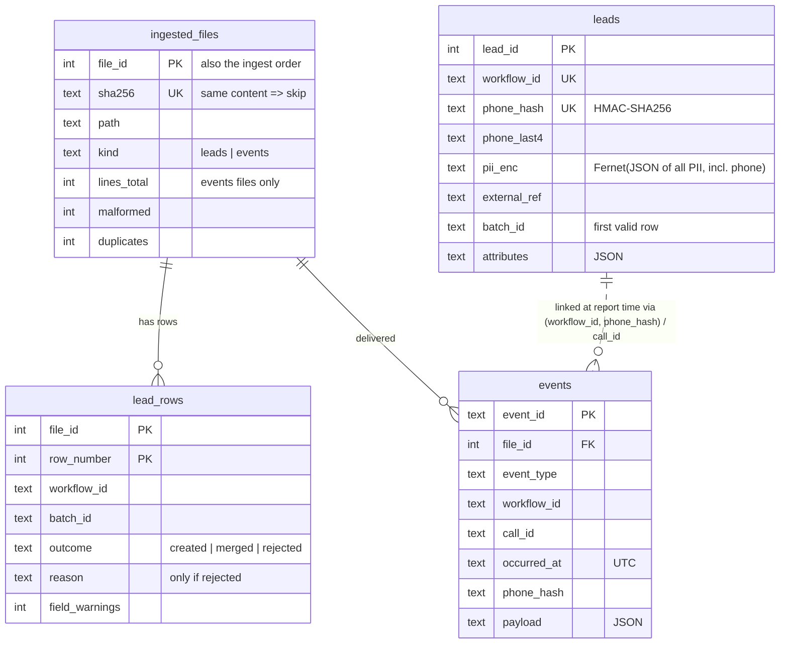

# Submission

## Candidate
- **Name:** Devansh Singh
- **Assignment chosen:** A (Data)
- **Time spent (honest estimate):** about 8–10 hours, including reading the spec, reviewing each step, and running and checking the results (see `AI_USAGE.md` for how AI was used)

## How to run
```bash
# setup (repo root, Python 3.11+)
python -m venv .venv
source .venv/bin/activate              # Windows: .venv\Scripts\activate
pip install -r requirements.txt
pip install -e solution                # installs the `ledger` command

# run (no key setup needed: the first ingest creates the PII keys in solution/.env)
python assignment-a-data/tools/generate_data.py --seed 42 --scale small --out data
ledger ingest data/drop_1
ledger ingest data/drop_2
ledger report --out reports/

# test, lint
cd solution && pytest
ruff check . && ruff format --check .
```
CI runs all of the above on Linux with Python 3.11 and 3.12 (`.github/workflows/tests.yml`). More detail is in [`solution/README.md`](solution/README.md).

## Interpretations that could change the output
The spec leaves these open. Each is one row in the decisions table below; these are the ones that can change a diffed number.
- **`lead_rows_total`** counts every non-blank data row: created + merged + rejected.
- **`field_warnings`** includes warnings on merged duplicate rows, but not on rejected rows.
- **`rejections_by_reason`** lists only reasons that occurred. Zero counts are omitted, since the set of `missing_required:<field>` reasons is open-ended.
- **`batch_summary.csv`** lists every uploaded batch, with zeros if none of its rows created a lead.
- **Orphans:** a non-override event with an invalid phone is an orphan, even if its `call_id` belongs to a linked call. Only overrides link through `call_id`.
- **Unknown codes:** an override with an unknown code is ignored, so the call falls back to the previous valid override or `disposition.set`.
- **`connectivity_rate`** uses Python's `f"{x:.4f}"`, which rounds half to even on exact ties.
- **Ties:** equal `occurred_at` is broken by `event_id`; equal call times by `call_id`; leads with equal `external_ref` by `batch_id`, then the masked phone.

## Design
```
drop_N/leads/<workflow>/*.csv ──► ingest_leads ──► lead_rows (every row, no PII)
                                   validate,        leads     (merged, PII encrypted)
                                   merge
drop_N/events/*.jsonl ───────────► ingest_events ─► events    (append-only ledger)
                                   malformed/dup
                                                        │
                    ledger report ◄── derive() ◄────────┘  link → calls → dispositions → buckets
                    (5 files)          recomputed from the DB on every report
```

**Two phases, deliberately separated:**
- **Ingest** records facts that never change once known:
  - whether a lead row was valid, and the merged lead it produced
  - whether an event line was malformed or a duplicate
  - the event itself, appended to the ledger
- **Report** derives everything that *can* change as more data arrives. That means orphans, call-to-lead links, effective dispositions, buckets and daily stats, all recomputed from the database each time. This is why an orphan from drop_1 counts once its lead arrives in drop_2, and why drop by drop, re-ingest and all at once give byte-identical reports.

**Idempotency:**
- Every input file is recorded by content hash and ingested inside one transaction. A re-run skips files it has already seen, and a crash leaves no half-ingested file.
- All data-quality counts are derived from tables rather than kept as running counters, so they can't drift.

**Code layout:**
- each spec rule is a small pure function (`normalize.py`, `validate_row`, and `effective_disposition`, `bucket_for` and friends in `derive.py`), unit-tested without a database
- thin I/O layers around them (`ingest_*.py`, `report.py`, `cli.py`)

### Database schema (SQLite)



| Table | Why it exists | What protects it |
|---|---|---|
| `ingested_files` | Makes `ingest` idempotent: a file whose sha256 is already recorded is skipped | `UNIQUE(sha256)`; each file is ingested in one transaction, so it's either fully in or not at all |
| `lead_rows` | One row per non-blank CSV row; the source for `rejections.csv` and every lead count in `data_quality.json`. No PII | `PRIMARY KEY(file_id, row_number)`; `CHECK` that only rejected rows have a reason |
| `leads` | The merged current state of each lead | `UNIQUE(workflow_id, phone_hash)` enforces lead identity |
| `events` | The append-only interaction ledger | Duplicates are filtered against an in-memory set of known `event_id`s so each file can be bulk-inserted; `PRIMARY KEY(event_id)` is the backstop (a missed duplicate fails the file instead of double-counting); triggers abort any UPDATE or DELETE |

**PII:** every phone is stored three ways:
- an HMAC-SHA256 hash, for matching and the UNIQUE constraint
- inside `pii_enc`: one Fernet token holding all of the lead's `pii: true` fields (phone, name), so real values can be recovered
- the plaintext last 4 digits, only for `phone_masked`

Nothing else about a person is stored. Keys come from `LEDGER_HMAC_KEY` and `LEDGER_FERNET_KEY` (see `solution/.env.example`). A plain SHA-256 would be unsafe: there are only about 4 billion valid mobile numbers, so every hash can be brute-forced.

## Decisions & assumptions
| Decision | Why | Alternative considered |
|---|---|---|
| Raw input files are treated as immutable; all derived state lives in the database | The grader runs the pipeline on fresh raw data, and orphan/duplicate status changes as drops arrive, so it can't live in files | Preprocessing copies of the data |
| Headers are trimmed again after collapsing `_`/whitespace runs | The spec trims before collapsing, so `phone_` would otherwise become `"phone "` and match nothing | Follow the spec's order literally |
| Dates require two-digit day and month (`1/2/2026` is invalid) | The spec writes the formats as `DD/MM/YYYY` etc., so I read them strictly | Accept single-digit day/month |
| Decimals round half-up (`10.005 → 10.01`) | Matches the everyday rounding used for money amounts | Python's default banker's rounding (half to even) |
| Commas in amounts are removed without checking their grouping | Indian grouping (`1,23,456`) must work, and the spec only says commas are thousands separators | Validate Western 3-digit grouping |
| SQLite rather than Postgres | No setup for the reviewer; a single-writer batch job fits SQLite; tests use a temporary database file | Postgres via the provided docker-compose |
| Files are identified by content hash (sha256), not by path | Re-running a drop is skipped even if the folder is moved or renamed | Key on file path |
| Data-quality counts are derived from tables, not kept as running counters | A count can't drift from the data, and re-runs can't double-count | A separate `ingest_stats` table |
| Orphan status is never stored; events are linked to leads at report time | An orphan from drop_1 is linked automatically once drop_2 brings its lead, and the result doesn't depend on ingest order | Mark orphans at insert time and re-check them later |
| Raw event lines are not stored | They contain the plaintext phone (PII); only the phone hash and the parsed fields are kept | Store raw lines encrypted |
| All `pii: true` fields (phone included) are stored as one encrypted JSON blob per lead | Driven by the schema's `pii` flags, so a new workflow needs no code change; one encryption per lead instead of two halved the Fernet cost at scale | One encrypted column per field (`phone_enc`, `name_enc`, ...) |
| Separate HMAC and Fernet keys | Each can be rotated without affecting the other | Derive both from one secret |
| Field defaults are applied when reading, not stored | The spec applies defaults after merging; applying them on read keeps that order-independent | Write defaults at ingest time |
| No SQLite `STRICT` tables; `CHECK` constraints instead | STRICT needs SQLite 3.37+, which an older Linux Python may not have | STRICT tables |
| Explicit `BEGIN`/`COMMIT` (`isolation_level=None`) | Works on Python 3.11; the `autocommit` attribute needs 3.12 | The sqlite3 module's implicit transactions |
| If two columns map to the same field, the first column wins | The spec doesn't cover it; deterministic and easy to explain | Last column wins, or reject the file |
| `lead_rows_total` counts every non-blank data row (created + merged + rejected) | It's the number of rows we read; the three outcomes then add up to it | Count only accepted rows |
| A phone that is present but invalid gives `invalid_phone` even if the field were optional | The spec states the phone rule without a required condition | Treat an optional bad phone as a field warning |
| A required non-phone field that is present but invalid is rejected as `invalid:<field>` | Can't happen with the given schemas (required fields are string or phone), but the code needs a rule | Treat it as missing |
| An invalid optional value in a duplicate row doesn't overwrite the stored value | The invalid value is stored as null, and nulls never overwrite (spec merge rule) | Overwrite with null |
| A non-null `external_ref` in a later duplicate overwrites the stored one | The spec's last-write-wins applies to every field; only `batch_id` is fixed | Keep the first reference |
| Short rows: missing trailing cells count as empty | Robust to ragged CSVs; required fields then give `missing_required` | Reject the file |
| CSVs are read as `utf-8-sig` | Handles files saved by Excel with a BOM; plain UTF-8 still works | Plain `utf-8` |
| A lead folder whose workflow has no schema is skipped with a warning | One unknown workflow shouldn't block the rest of the drop | Fail the whole ingest |
| Malformed means: invalid UTF-8, invalid JSON, not a JSON object, or `event_id` missing, null or empty | Each of these leaves us with no usable event identity | Only "invalid JSON or missing key" |
| Whitespace-only lines are not counted in `events_total` | The spec counts "non-empty" lines, and a whitespace line has no content | Count them as malformed |
| A non-string `event_id` (e.g. `42`) is accepted as the string `"42"` | It still identifies the event uniquely | Treat it as malformed |
| For a duplicate `event_id`, the first copy wins even if later copies differ | The ledger is append-only, and the spec drops duplicates | Last copy wins |
| An event with an unparseable `occurred_at` is stored with a null timestamp, not counted as malformed | The spec's malformed rule covers only JSON and `event_id`; such a call simply can't be dated | Count it as malformed |
| Timestamps are stored as fixed-width UTC ISO strings (microseconds) | Sorting the strings sorts by time, both in SQL and in Python | Store epoch integers |
| Ties on `occurred_at` (e.g. two overrides at the same second) are broken by `event_id` | Deterministic and independent of the order files were ingested | Break ties by file or line order |
| A non-override event with an invalid phone is an orphan, even if its `call_id` belongs to a linked call | The spec links these events only by phone; only overrides link through `call_id` | Link every event through `call_id` |
| A call's lead is decided by its `call.initiated` event, or else by its earliest linked event | Gives overrides one unambiguous lead, even in the unlikely case a call's events carry different phones | Take whichever event comes first |
| An override with an unknown code is counted as unknown and ignored, so the call falls back to the next valid override or `disposition.set` | The spec says unknown dispositions are "ignored"; an invalid correction shouldn't erase a valid outcome | Treat the call as having no disposition |
| Codes are checked against the catalogue of the **lead's** workflow | Catalogues differ per workflow (`feedback_captured` isn't valid for `motor_renewal`) | Check against any workflow |
| A call needs a `call.initiated` with a parseable time; with several initiated events, the earliest one is used | A call's date comes from that event, so it must be datable | Count calls without a time under no date |
| `current_disposition` ties on the same initiated time are broken by `call_id` | Deterministic | Arbitrary order |
| All derived facts (links, orphans, calls, buckets) are recomputed from the database on every `report` | Reports always reflect everything ingested so far; I verified that drop-by-drop gives the same result as one run | Store them incrementally (faster, but they go stale when a late lead arrives) |
| `connectivity_rate` is formatted with Python's `f"{x:.4f}"` | The standard formatting; exact ties at the 5th decimal (e.g. 1/32) are rare and round half-to-even | Decimal round-half-up |
| `batch_summary.csv` lists every batch that was uploaded, with zeros if none of its rows created a lead | "How is Monday's upload doing?" should show the batch even if it was all duplicates or rejections | List only batches that own leads |
| `ingest` accepts several drops and processes them in the given order | `ingest drop_1 drop_2` is the "all at once" form; drop order decides which duplicate row is first | Sort drops by name |
| `report` never needs the PII keys | Masking uses the stored last 4 digits, so reports can run with fewer privileges | Decrypt the phone to mask it |
| CSVs use `\n` line endings and UTF-8 | Byte-identical output on Windows and Linux; the spec allows `\n` | The platform default (`\r\n` on Windows) |
| No secondary indexes on `events` | Reports read the whole ledger in one scan, so the indexes were never used, and maintaining two random-key indexes was a large share of bulk-insert time | Index `(workflow_id, phone_hash)` and `call_id` |
| Each file is buffered in memory and written with `executemany` (leads are merged in memory first) | Single-row `execute` calls dominated the profile; a file is at most a few thousand rows, so memory is not a concern | One `INSERT`/`SELECT` per row |
| SQLite page cache raised to 64 MB | The 2 MB default thrashed on random-key indexes during large ingests | Default cache |
| If neither PII key is set, `ingest` creates both in the git-ignored `solution/.env` and warns | A fresh clone (or an automated grader) runs with no manual step, and keys still never reach git. Exactly one key set is an error | Refuse to run until keys are configured |
| The first ingest stores a check value for each key in a `meta` table; later ingests with other keys are refused | Different keys would silently break phone matching and make stored PII unreadable | No check |
| A file whose logical name (`drop/leads/<wf>/<file>`, `drop/events/<file>`) was already ingested with different content is refused | Merging a corrected re-send on top of the original would count its rows twice; an operator must decide | Ingest it as a new file (the old behaviour), or replace the old one |
| `ingest` stops at the first unreadable or refused file (exit 1); files before it stay ingested and a re-run skips them | Lead files must go in order, because the first valid row of a lead decides its `batch_id` | Skip the bad file and continue |
| `lead_report.csv` ties on `external_ref` are broken by `batch_id`, then the masked phone | The spec sorts by `(workflow_id, external_ref)` only; two customers can share a reference | Leave ties in database order |

## Failure modes considered
**Handled:**
- **Re-running `ingest` on a drop already ingested:** each file is skipped by its sha256, so nothing changes. Tested, and also checked byte for byte on 5 seeds.
- **Crash mid-file:** each file is one transaction, so it is either fully ingested and recorded, or not at all. Re-running picks up the files that didn't make it.
- **Events before their lead:** linking happens at report time, so orphans heal when the lead arrives.
- **Ingest order:** drop by drop, re-ingest and "all at once" give byte-identical reports. This is tested end to end, and checked on seeds 1, 7, 99, 123 and 2026 plus 42.
- **Dirty input:** six phone formats, bad dates and amounts, blank rows, ragged rows, renamed and extra columns, BOMs, truncated JSON, invalid UTF-8, duplicate events within and across drops, overrides without phones, unknown codes.
- **Duplicate-detection bug:** the `event_id` primary key is a backstop. If the in-memory duplicate check were ever wrong, the file fails and rolls back instead of double-counting. Tested.
- **No keys on a fresh clone:** created automatically in `solution/.env`, with a warning. Only one key set, or a missing drop folder, gives a clear error and a non-zero exit. `report` doesn't need keys at all.
- **Keys that don't match the database** (lost or changed `.env`): refused with a clear error, instead of silently breaking matching. Tested.
- **A re-sent file with the same name but changed content:** refused, and the database is unchanged. Tested.
- **An unreadable lead file** (not UTF-8, broken CSV): a clear error naming the file instead of a traceback. Files before it stay ingested, nothing from it is kept, and a re-run continues from it. Tested.
- **Accidental edits to the ledger:** triggers reject UPDATE and DELETE on `events`.

**Not handled / known limits:**
- **Replacing a corrected file:** a changed re-send is refused, but there's no command to replace the original (it would mean un-merging lead rows). For now the fix is to rebuild the database from the raw drops.
- **Key rotation:** there's no `MultiFernet` or re-hash migration. Lost keys make the stored PII unrecoverable; the database refuses other keys, so the only way forward is to rebuild from the raw drops.
- **Renamed folders:** changed-file detection uses the last path parts (`drop_1/leads/…`), so a re-send under a different drop name isn't detected as a change.
- **Concurrent `ingest` runs on the same database:** SQLite serialises writers, but nothing coordinates two processes ingesting the same drop.
- **Memory:** `report` loads all events into memory (about 600k rows is fine). Tens of millions would need the aggregation moved into SQL.
- **The same `call_id` appearing under two different leads' phones** is resolved deterministically, but not reported.

## Testing
`cd solution && pytest`: 209 tests in about 4 s, passing on Python 3.11.4 (SQLite 3.42) and 3.12 locally, and in CI on Linux. `ruff check` and `ruff format --check` are clean.
- **Unit, table-driven:**
  - every normaliser (phone formats, impossible dates, currency prefixes, enums, the three timestamp forms)
  - header mapping
  - row validation order and warnings
  - the effective-disposition rules, including tie-breaks
  - every bucket branch and its precedence
  - linking (overrides through `call_id`)
  - daily IST date boundaries
- **Database:** constraints, append-only triggers, transaction rollback, and an IntegrityError backstop when the in-memory duplicate set is stale.
- **Ingest:** blank-row numbering, merges within and across files, first `batch_id` kept, re-ingest is a no-op, no plaintext PII in any table, non-UTF-8 and changed files refused with nothing kept.
- **Reports:** exact file contents for a hand-built case, key order of `data_quality.json`, empty database.
- **End to end through the CLI** (seed 7): byte-identical reports across drop by drop, re-ingest and all at once; internal consistency; sort orders; formats; no 10-digit numbers in any output.
- **CLI key handling:** keys are created on the first run and reused on the next; a single key is refused; keys that don't match the database are refused. The CLI stops at a bad file and resumes after it's fixed.

**Outside the test suite** (scripted, see Results):
- the same identity and invariant checks on seeds 1, 7, 99, 123 and 2026
- the large dataset compared byte for byte before and after the performance work
- seeds 42 and 7 compared byte for byte before and after every change in the final improvement round (key handling, ordering, file errors, formatting)

**Not tested:**
- Postgres
- concurrent writers
- files over a few hundred MB
- a hand-computed oracle for a full generated dataset. The rules are checked individually; spec-interpretation risks are listed under Decisions.

## Results
Measured on a Windows laptop (Python 3.12, SQLite 3.45):

| Dataset | Ingest | Report | Total |
|---|---|---|---|
| seed 42, small (2,057 lead rows, 8,745 event lines) | ~1.5 s | <1 s | ~2 s |
| seed 42, large (143,990 lead rows, 632,602 event lines) | 91 s | 24 s | **115 s** (two runs: 114.7 s, 116.4 s) |

**Large dataset, before and after profiling** (all 5 reports byte-identical at every stage):

| Change | Total |
|---|---|
| First version | 418 s |
| 64 MB page cache, drop the 2 unused event indexes, `executemany` for events | 168 s |
| Leads buffered per file + one Fernet token per lead (was two) | 121 s |
| `derive()`: one pass instead of sorting all events to find each call's lead; non-frozen `Event` | **115 s** |

Profiling (cProfile) showed the time was inside SQLite's `execute`, not in my Python code: about 100 µs per single-row statement because of index-page cache misses. Under the 2-minute target, but with little margin on this laptop.

**Multi-seed check** (small): for seeds 1, 7, 99, 123 and 2026, drop by drop, re-ingest and all at once gave byte-identical reports, and these invariants held:
- rows = leads + merged + rejected
- batch totals = leads
- daily calls = lead calls
- `ever_success` ⇒ completed
- connected ≤ total

Leads ranged from 1886 to 1912 and orphans from 422 to 541.

Seed 42 small, `data_quality.json`:
- 2057 lead rows: 108 rejected, 57 merged, 122 field warnings
- 8745 event lines: 8 malformed, 237 duplicates, 462 orphans, 18 unknown dispositions

Orphans fall from 1123 after drop_1 to 462 after drop_2 as late leads arrive. Two values from the spec's own examples appear in my output: `connectivity_rate` 0.5625 for motor_renewal on 2026-10-01, and `last_call_at` 2026-10-14T17:55:24+05:30 for MOT/2026/100000.

## If I had another day
1. **More performance margin** (115 s is only just under 2 min):
   - Fernet is now the largest Python cost. AES-GCM via `cryptography` is faster.
   - Move the report aggregation into SQL (window functions for the latest override) rather than building 600k Python objects.
2. **Key rotation:** `MultiFernet` for encryption keys, plus a re-hash migration for the HMAC key.
3. **Replace a corrected file:** a `ledger replace <file>` that rebuilds the affected workflow's leads from the remaining files, instead of refusing the re-send.
4. **Production at 100k leads/day:**
   - a scheduler running `ingest` per drop
   - Postgres with `COPY` into staging tables
   - an alert on spikes in rejections or orphans
   - backfills by re-running `ingest`, which is safe because it's idempotent
